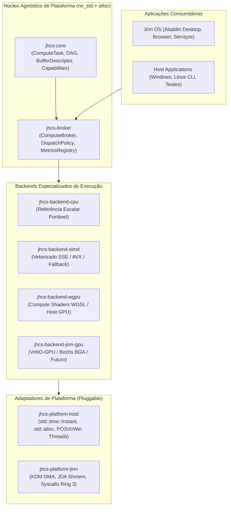

# 🏛️ JHCS — Arquitetura Multiplataforma do Sistema

> **Documento Oficial de Engenharia do Projeto JHCS**  
> **Status:** Ativo | **Camada:** Aplicação & Biblioteca Rust | **Multiplataforma:** Host (Win/Linux) & Jinn Ring 3  

---

## 1. Visão Arquitetural

O **Jinn Heterogeneous Compute Service (JHCS)** desacopla completamente o consumidor de capacidade computacional da implementação física do hardware. A biblioteca é estruturada em três camadas independentes:

---

## 2. Princípios de Isolamento e Não-Dependência

1. **`jhcs-core` é universal e puro:**
   * Não referencia `std`.
   * Não referencia APIs de janela, drivers gráficos ou bibliotecas proprietárias.
   * Não assume que dados residem na memória da CPU (`Vec<f32>` é evitado no contrato abstrato em favor de `BufferHandle`).
2. **Aceleração é Opcional por Construção:**
   * O sistema inicializa e opera com 100% de sucesso caso nenhuma GPU ou instrução vetorial esteja disponível.
   * O backend escalar `jhcs-backend-cpu` é sempre compilado e fornece a base de comparação para validação de precisão dos demais backends.
3. **Desacoplamento de Host e Jinn:**
   * O desenvolvimento, medição de benchmarks e prototipagem de algoritmos podem ser realizados no Windows e Linux sem necessitar recompilar a imagem do sistema operacional.
   * O adaptador nativo `jhcs-platform-jinn` consome estritamente as syscalls documentadas do microkernel (KDM 60..68, JDA 12..29).
