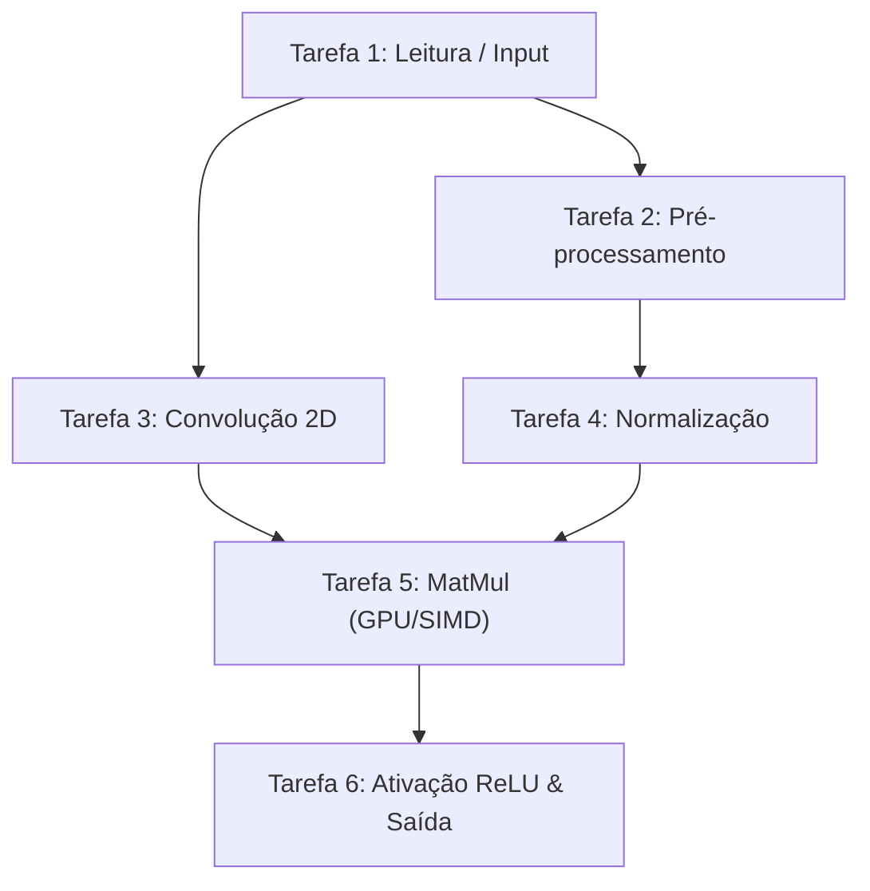

# 🕸️ JHCS — Especificação do Grafo de Computação (DAG)

> **Documento Oficial de Engenharia — jhcs-rs**  
> **Status:** Ativo | **Módulo:** `jhcs-core::graph`

---

## 1. O Modelo de Grafo Acíclico Dirigido (DAG)

No JHCS, uma carga de trabalho computacional complexa não é representada como uma lista plana de comandos síncronos, mas como um **Grafo Acíclico Dirigido** ($G = (V, E)$), onde:
* Cada vértice $v \in V$ é uma `ComputeTask` contendo um `TaskId`, um `OperationId`, conjuntos de buffers de entrada/saída (`BufferSet`) e requisitos de execução (`ComputeRequirements`).
* Cada aresta direcionada $(u, v) \in E$ indica que a tarefa $v$ depende estritamente da conclusão bem-sucedida da tarefa $u$.

---

## 2. Algoritmos de Resolução e Escalonamento

### 2.1. Detecção de Ciclos & Ordenação Topológica
O método `ComputeGraph::topological_order()` emprega o **Algoritmo de Kahn** com complexidade temporal $O(|V| + |E|)$:
1. Calcula o grau de entrada (*in-degree*) de cada nó (quantidade de dependências não resolvidas).
2. Enfileira todos os nós com *in-degree* zero em uma fila de tarefas prontas (`ready`).
3. Enquanto houver nós prontos, remove $u$, insere-o na lista de ordem e decrementa o *in-degree* de todos os nós filhos que dependem de $u$.
4. Se o número total de nós ordenados for estritamente menor que $|V|$, **um ciclo é detectado** e o método retorna `Err(ComputeError::CycleDetected)`.

### 2.2. Agrupamento em Estágios Independentes (`execution_batches`)
O método `ComputeGraph::execution_batches()` divide o grafo em fases ordenadas:
$$\text{Grafo} \implies [\text{Batch}_0, \text{Batch}_1, \dots, \text{Batch}_k]$$
* **Garantia de Independência:** Todas as tarefas pertencentes ao mesmo `Batch_i` são **100% independentes entre si**.
* **Paralelismo Máximo:** O Compute Broker pode despachar as tarefas de um mesmo lote simultaneamente para diferentes núcleos de CPU, unidades SIMD ou filas de GPU, sem necessidade de sincronização mútua durante o estágio.
