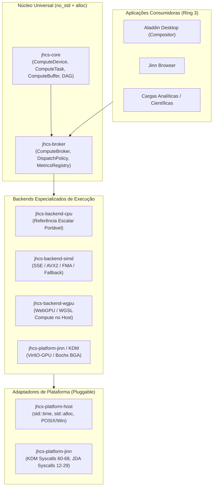

# 🏛️ JHCS — Arquitetura Oficial do Sistema

> **Documento Oficial de Engenharia do Ecossistema Jinn**  
> **Status:** Ativo & Especificado | **Camada:** Ring 3 (Espaço de Usuário)  
> **Multiplataforma:** Host (Windows/Linux) & Jinn OS (`x86_64-unknown-none`)  
> **Princípio Fundamental:** **Heterogeneous Computing by Design**

---

## 1. Visão Arquitetural

O **Jinn Heterogeneous Compute Service (JHCS)** desacopla completamente o consumidor de capacidade computacional da implementação física do hardware.

O sistema trata CPU, FPU, SIMD e GPU como **recursos complementares e cooperativos**. Nenhum acelerador específico é obrigatório para a inicialização ou continuidade do serviço:

- A ausência de GPU resulta em execução por CPU sem perda de funcionalidade.
- A ausência de instruções SIMD específicas resulta em fallback para execução escalar.
- Falhas em drivers de aceleração são isoladas em Ring 3, sem pânico no microkernel.

---

## 2. Invariantes de Engenharia

1. **`jhcs-core` é universal e determinístico:**
   - Suporta integralmente `#![no_std]` + `alloc`.
   - Não depende de bibliotecas de janelas, frameworks proprietários ou runtime de SO específico.
   - Não expõe ponteiros físicos de memória às aplicações.

2. **Aceleração Opcional por Construção:**
   - O backend escalar (`jhcs-backend-cpu`) compila em 100% dos cenários e atua como gabarito numérico oficial para verificar a paridade matemática ($\epsilon < 10^{-4}$) de qualquer unidade SIMD ou GPU.

3. **Isolamento Estrito entre Ring 0 e Ring 3:**
   - O microkernel gerencia unicamente memória física, paginação, isolamento de DMA (KDM) e troca de contexto de registradores FPU/SIMD (`FXSAVE`/`XSAVE`).
   - Toda lógica de agendamento de tarefas, grafo DAG, compilação de shaders e despacho computacional reside no JHCS em Ring 3.
