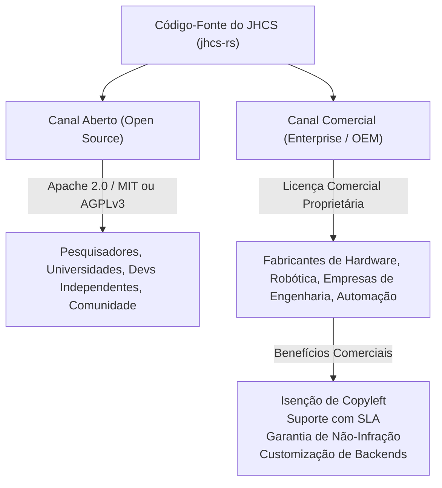

# ⚖️ JHCS — Política de Licenciamento, Propriedade Intelectual e Governança

> **Documento Oficial de Estratégia Jurídica e Comercial — jhcs-rs**  
> **Status:** Ativo | **Arquitetura de Licenciamento:** Open Source Transparente com Modelo Comercial Duplo

---

## 1. O Papel do Código Aberto no Ecossistema Jinn e JHCS

Manter os repositórios públicos e transparentes não é uma concessão ingênua, mas uma decisão estratégica fundamentada em vantagens objetivas de engenharia e mercado:
* **Demonstração Inegável de Capacidade de Execução:** O código em funcionamento comprova competência técnica de entrega a potenciais parceiros, investidores e clientes industriais.
* **Auditabilidade e Segurança:** Permite escrutínio público por pesquisadores e especialistas em segurança, eliminando suspeitas de código obscuro.
* **Colaboração Científica e Acadêmica:** Facilita a adoção da arquitetura por universidades e grupos de pesquisa em sistemas operacionais e computação paralela.
* **Histórico Público de Desenvolvimento:** Estabelece prioridade temporal e autoria técnica sobre as inovações concebidas no projeto.
* **Credibilidade:** Nenhum ecossistema de infraestrutura de sistemas atinge adoção ampla sem transparência arquitetural.

> **Princípio Fundamental:** Código aberto protege a transparência e amplia a distribuição; a exploração comercial sustentável é protegida por governança consciente de propriedade intelectual e modelo de duplo licenciamento.

---

## 2. Desmistificação Jurídica do Copyleft e da AGPLv3

Para orientar decisões comerciais sem equívocos técnicos, é essencial delimitar o que licenças com copyleft estrito (como a AGPLv3) efetivamente produzem no direito autoral:

| Hipótese / Afirmação | Análise Jurídica Real | Implicação para o JHCS |
|---|---|---|
| *"Modificações distribuídas precisam ter código aberto."* | **Correto.** A redistribuição de binários contendo modificações da biblioteca exige o fornecimento do código modificado correspondente. | Garante que melhorias no núcleo do JHCS retornem à comunidade. |
| *"Uso em rede gera obrigação de abrir o código."* | **Correto.** Se o próprio JHCS for modificado e ofertado como serviço remoto (SaaS), o código da versão modificada deve ser fornecido aos usuários da rede. | Evita que provedores de nuvem usem melhorias proprietárias sem contribuir. |
| *"Toda aplicação que consumir o JHCS é obrigada a se abrir."* | **Incorreto.** A vinculação dinâmica, o consumo via IPC ou a comunicação por cliente-servidor não transformam automaticamente toda a aplicação em obra derivada sob copyleft. | Clientes comerciais podem usar o JHCS sem receio de contaminação de sua lógica de negócio interna. |
| *"Qualquer empresa que usar JHCS comercialmente é forçada a comprar licença."* | **Incorreto.** Empresas podem utilizar legalmente o software sob a licença pública, desde que cumpram os termos da licença. | A compra de licença comercial decorre da necessidade de suporte garantido, SLAs, customizações proprietárias ou dispensa de cláusulas de copyleft. |
| *"É possível ofertar licença comercial alternativa."* | **Correto.** O detentor original dos direitos autorais pode licenciar o mesmo software sob múltiplos regimes contratuais simultâneos (*dual-licensing*). | Base da monetização comercial sustentável do JHCS. |

---

## 3. Modelo Estratégico de Duplo Licenciamento (*Dual-Licensing*)

O projeto estrutura sua distribuição em dois regimes contratuais paralelos:

### 3.1. Canal Comunitário e Acadêmico (Open Source)
* Disponibilizado publicamente em repositório aberto.
* Licenciamento permissivo (**Apache 2.0 / MIT**) para as abstrações fundamentais (`jhcs-core`, `jhcs-platform`), maximizando a interoperabilidade com ecossistemas existentes.
* Cláusulas claras de atribuição e isenção de responsabilidade.

### 3.2. Canal Comercial / OEM (Enterprise License)
Destinado a empresas que integram o JHCS em produtos proprietários fechados ou demandam garantias contratuais:
* **Isenção de Cláusulas de Auditoria Pública:** Permite embutir o JHCS em firmwares, robôs, equipamentos médicos ou suítes de CAD sem expor código adjacente.
* **Garantia de Indenização por Propriedade Intelectual (IP Indemnity):** Proteção contratual contra reivindicações de patentes de terceiros.
* **Suporte Técnico Dedicado e SLAs:** Consultoria de engenharia para otimização de backends em hardware proprietário.
* **Desenvolvimento sob Demanda:** Criação de adaptadores de plataforma ou aceleradores dedicados sob contrato comercial.

---

## 4. Política de Titularidade e Governança de Contribuições (CLA)

Para manter a viabilidade jurídica do licenciamento duplo ao longo do tempo, o projeto adota uma salvaguarda obrigatória:

1. **Titularidade Central:**
   * A totalidade dos direitos autorais das versões oficiais do JHCS permanece unificada sob os mantenedores oficiais do projeto.
2. **Contributor License Agreement (CLA):**
   * Antes da aceitação de qualquer contribuição externa substancial via Pull Request, o colaborador assinará eletronicamente um CLA padronizado (conforme o modelo canônico da Apache Software Foundation).
   * O CLA concede ao projeto uma licença perpétua, mundial, irrevogável e livre de royalties para sublicenciar, comercializar e redistribuir o código sob qualquer regime de licença futuro.
3. **Auditoria de Dependências de Terceiros:**
   * Todas as dependências externas inseridas no `Cargo.toml` devem possuir licenças compatíveis (MIT, Apache 2.0, BSD-3-Clause). É vedada a introdução de dependências virais (GPL estrita) no núcleo `jhcs-core`.
